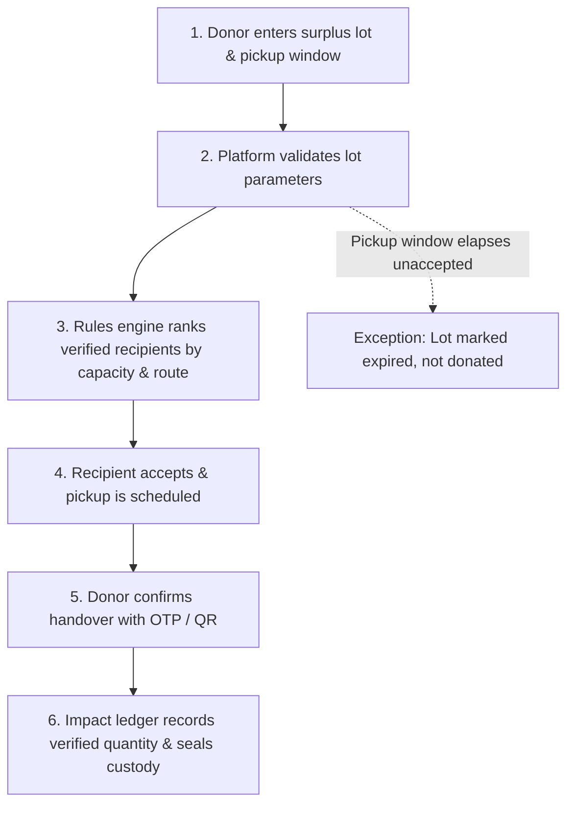

# FoodLoop Dispatch

> A surplus-food matching and pickup coordination platform with time-window logistics and verified proof-of-handover (NYLP 2026 concept & design study).

---

## 1. Problem

Usable surplus food from cafeterias, bakeries, and grocery stores is routinely discarded because local charities lack timely notice of available donations and actionable pickup windows.

Key operational pain points:
* **Time Expiration:** Surplus offers expire before eligible recipient charities can respond.
* **Unclear Logistics:** Food quantities, storage conditions, and pickup windows are ambiguously communicated.
* **Missing Chain of Custody:** Donors lack an auditable, verified record confirming when and to whom food was transferred.

---

## 2. Solution

FoodLoop Dispatch automates surplus coordination across three user roles: **donor outlets**, **charity coordinators**, and **volunteer dispatchers**. 

The platform checks required lot parameters, deterministically ranks verified local charities by capacity and geographic proximity, locks the lot upon acceptance to prevent double-claims, and closes the donation via donor-confirmed OTP/QR proof-of-handover. Unaccepted lots past their deadline are marked expired without recording unearned impact credit.

---

## 3. Key Features (Built in Codebase)

* **Surplus Lot Posting:** Donors list food lots with verified quantity, unit (`meals` or `kg`), and strict pickup windows (`app/api/lots/route.ts`).
* **Deterministic Matching Engine:** Eliminates unverified or under-capacity organizations and ranks eligible recipients by capacity fit and Haversine geographic distance (`lib/matcher.ts`).
* **Donor Authorization Review Gate:** Explicit human review action requiring donor approval before offers are dispatched to partner charities (`app/page.tsx`).
* **Atomic Claim & Scheduling:** Locks the lot to the first accepting charity coordinator, rejects competing offers, and schedules pickup (`app/api/offers/[id]/accept/route.ts`).
* **OTP / QR Proof-of-Handover:** Generates a 6-digit numeric OTP and paired QR token (`FOODLOOP:v1:HANDOVER:...`); handover must be confirmed by the donor outlet to close the chain of custody (`lib/handover.ts`, `components/HandoverCard.tsx`).
* **Verified Impact Ledger:** Computes collected lots, diverted kilograms, and median acceptance time exclusively from donor-confirmed handovers (`lib/store.ts`).
* **Exception Expiry Branch:** Automatically marks unaccepted lots as expired once the pickup window elapses, ensuring uncollected food is never claimed as donated (`app/api/lots/[id]/expire/route.ts`).
* **Simulated Sample Data:** All demonstration quantities in the coordination desk are labeled as simulated sample data, not pilot findings (`lib/store.ts`, `app/page.tsx`).

---

## 4. Screenshots

Screenshots should be captured and placed in the [`docs/screenshots/`](docs/screenshots/) folder:

1. **Donation Coordination Desk (Dashboard)**
   
   *[TODO: add screenshot of the three-panel coordination desk showing counters and work queue]*

2. **Surplus Lot Creation Modal**
   
   *[TODO: add screenshot of donor entering meals and pickup window]*

3. **Matched Partners Task View**
   
   *[TODO: add screenshot of ranked eligible recipients with "Offer to eligible partners" review button]*

4. **Pickup & Handover Confirmation Card**
   
   *[TODO: add screenshot of 6-digit OTP and SVG QR code verification view]*

5. **Expired Lot Exception State**
   
   *[TODO: add screenshot showing expired unaccepted lot blocked from acceptance]*

---

## 5. Tech Stack

* **Framework:** [Next.js](https://nextjs.org/) 16.4.2 (App Router, Turbopack)
* **Frontend:** [React](https://react.dev/) 19.3.0, [TypeScript](https://www.typescriptlang.org/) 5, [Tailwind CSS](https://tailwindcss.com/) 4
* **State & Persistence:** In-memory transactional `WorkEngineStore` ([lib/store.ts](lib/store.ts)) with Supabase client client library ([@supabase/supabase-js](https://supabase.com/))
* **AI & NLP:** Google Generative Language API (`gemini-3.8-flash` via [app/api/parse/route.ts](app/api/parse/route.ts))
* **Test Runner:** Node.js native test runner executed via `tsx` ([package.json](package.json))

---

## 6. Architecture & Workflow

### 6-Step Donation Workflow



### Schema Entities (8 Entities)
Implemented in [lib/types.ts](lib/types.ts) and backed by [lib/store.ts](lib/store.ts):
1. `donor`: Donor outlet details and location.
2. `recipient`: Verified charity coordinator profile and capacity.
3. `eligibility`: Rules criteria, supported units, and capacity thresholds.
4. `lot`: Surplus food lot, pickup window start/end, and status (`open`, `matched`, `accepted`, `completed`, `expired`).
5. `offer`: Ranked eligible match presented to recipient (`pending`, `accepted`, `rejected`, `expired`).
6. `pickup`: Scheduled collection logistics (`scheduled`, `completed`, `cancelled`).
7. `handover`: 6-digit OTP, QR payload, and donor confirmation timestamp.
8. `audit_event`: Immutable audit trail recorded on every state transition.

---

## 7. Setup and Run

### Prerequisites
* Node.js v20+ (tested on Node v26)
* npm v10+

### Step-by-Step Installation

```bash
# 1. Clone the repository
git clone https://github.com/aishasyeda2005/foodloop.git
cd foodloop

# 2. Install dependencies
npm install

# 3. Configure environment variables
cp .env.example .env.local

# 4. Start the local development server
npm run dev
```

Open your browser at **[http://localhost:3000](http://localhost:3000)**.

To build for production:
```bash
npm run build
npm run start
```

---

## 8. Environment Variables

Create a `.env.local` file in the project root based on `.env.example`:

| Variable Name | Required | Description |
| :--- | :---: | :--- |
| `GEMINI_API_KEY` | Optional | API key for Google Gemini model (`gemini-3.8-flash`) used in `/api/parse` for unstructured message parsing. |
| `NEXT_PUBLIC_SUPABASE_URL` | Optional | URL for remote Supabase PostgreSQL project. |
| `NEXT_PUBLIC_SUPABASE_ANON_KEY` | Optional | Public anonymous API key for Supabase client. |

*(Note: The platform is fully functional locally using the in-memory store even without external API credentials).*

---

## 9. AI Methodology and Model/API Usage

### What is AI-Driven vs. What is Rule-Based
* **AI-Driven (Form Assistant):**
  * **Model / Provider:** Google Generative Language API — `gemini-3.8-flash`
  * **File:** [app/api/parse/route.ts](app/api/parse/route.ts)
  * **Input:** Raw conversational chat string (e.g., *"Campus Cafeteria has 25 packed meals ready for pickup before 4:30 PM"*).
  * **Output:** Structured JSON schema `{ item: string, quantity: number, minutes: number }`.
  * **Role:** Assistant tool used only to prefill the lot creation form from free-form text.
* **100% Rule-Based & Deterministic (No AI Decision Making):**
  * **Matching & Ranking:** Recipient filtering and scoring are strictly deterministic code formulas ([lib/matcher.ts](lib/matcher.ts)) based on verified status, capacity ratio, and Haversine geographic distance.
  * **State Transitions:** Offers, pickups, handovers, and expiry are governed exclusively by verified transactional rules ([lib/store.ts](lib/store.ts)).
  * **Human Authorization Required:** The donor must explicitly click **"Offer to eligible partners"** before any notification is dispatched. The charity coordinator must explicitly accept the offer. The donor outlet must explicitly confirm the OTP/QR code at physical handover.

---

## 10. Testing

Run the automated test suite with:

```bash
npm test
```

The automated test runner ([tests/mandatory_rules.test.ts](tests/mandatory_rules.test.ts)) verifies all mandatory failure conditions and an end-to-end user story:

* **Mandatory Failure Test 1 (Section H):** An expired lot cannot be accepted (`410 Gone`).
* **Mandatory Failure Test 2 (Section H):** Two recipients cannot claim the same lot (`409 Conflict`).
* **Mandatory Failure Test 3 (Section H):** Impact counts include **only** confirmed handovers.
* **End-to-End Story (Sections C, D):** 25 meals listed for collection within 90 minutes $\rightarrow$ matched $\rightarrow$ accepted $\rightarrow$ OTP/QR handover closed $\rightarrow$ verified 10.0 kg diverted.

---

## 11. Demo and Live Link

* **Live Product Link:** [TODO: live product URL]
* **Demo Video Link:** [TODO: demo video URL]

---

## 12. Team Contributions

| Name | Role | Contribution |
| :--- | :--- | :--- |
| Syeda Aisha | Full-Stack Developer | [TODO: detail specific contribution, e.g., concept design, UI implementation, matching engine] |
| [TODO: Teammate Name] | [TODO: Role] | [TODO: Contribution details] |

---

## 13. Limitations and Safety Boundary

* **Food-Safety Boundary (Anti-Hallucination Rule 5):** The software **never** evaluates or certifies whether food is safe or edible. Responsibility for food safety certification, legal suitability, proper temperature maintenance, and safe handling stays solely with the donor outlet and recipient organization.
* **Out of Scope (Planned for Future Expansion):** Multi-stop vehicle route batching, dynamic fleet dispatch, and automated ESG regulatory reporting dashboards are not part of this MVP and are planned for future versions.
